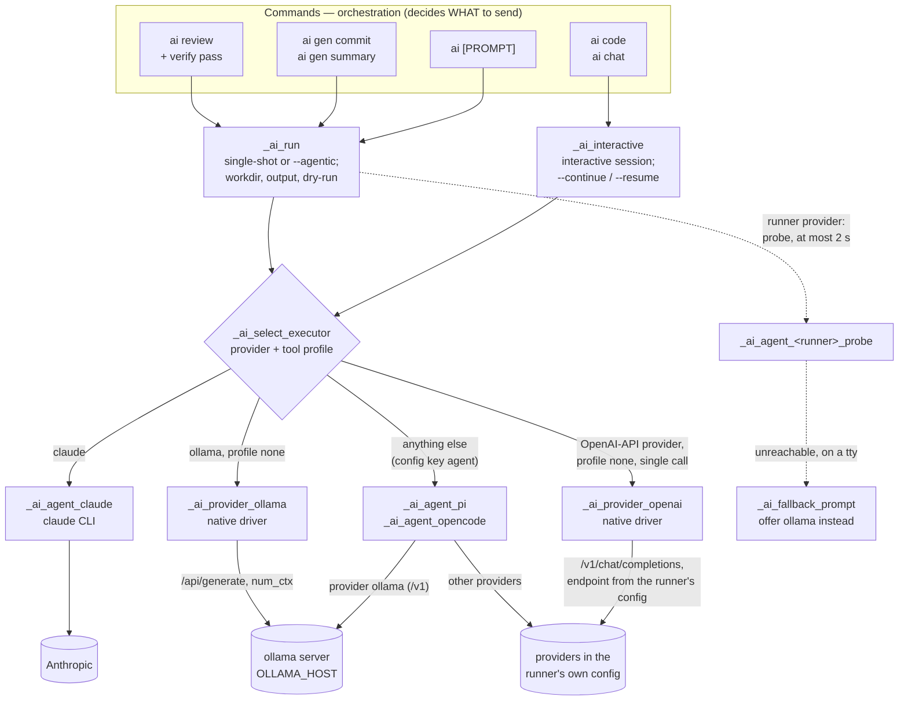

# AI toolkit architecture

> See also: [Toolkit reference](toolkit.md) · [How-to](howto.md)

This document describes how the `ai` toolkit is put together: its layers, the two kinds of
executor behind every model call, the contracts between them, and the invariants that should stay
true as the code changes. Command names appear only as illustrations; user-facing behavior is in
[toolkit.md](toolkit.md).

## Goals

`ai` is a fish-native front end for local (Ollama) and cloud models. It exists to:

1. Own the parts nobody else does: **review orchestration** (which diff, context budget, lenses,
   two-pass verify with separate files), `ai gen`, and a **native ollama call** with per-request
   `num_ctx` sizing and thinking quarantine.
2. Hand everything else to tools that already do it: agent loops, sessions, cloud providers and
   their keys live in agent CLIs (pi, opencode, claude). `ai` passes them a provider/model name
   and a tool profile, nothing more.
3. Keep preferences per task and per project, with one place that shows where each value came
   from (`ai config status`).
4. Keep prompts user-editable (`prompts/*.md`, `prompts/lenses/*.md`) without touching shell code.
5. Stay fish-idiomatic: autoloaded functions, `stow` symlinks, no heavy dependencies (`jq`,
   `curl`, `tree` and the agent CLIs you choose to install).

## System overview



**Layers (top-down):**

| Layer | Responsibility | Lives in |
|---|---|---|
| Command handlers | The user-facing command: resolve task provider/model, assemble the prompt and its context (by mode, see [Context policy](#context-policy)) | `_ai_review*`, `_ai_gen_*`, `_ai_code`, `_ai_chat`, `ai` |
| Prompt templates | What to say — review rules, lenses, verify rules, commit/summary prompts | `prompts/meta-*.md`, `prompts/lenses/*.md` |
| Dispatch | Single-shot: `_ai_run` (and `_ai_run_watched` for file output with progress). Interactive: `_ai_interactive` | `_ai_run`, `_ai_run_watched`, `_ai_interactive` |
| Executor selection | Which executor serves this provider and profile; which model it gets | `_ai_select_executor`, `_ai_executor_model` |
| Executors | How to invoke one tool | `_ai_provider_ollama`, `_ai_provider_openai` (native drivers), `_ai_agent_{pi,opencode,claude}` (runners) |
| Config | Pure resolvers over `key=value` files (project walk-up, then global) | `_ai_config_*`, `_ai_default_*`, `_ai_origin_*` |

## Executors

Every model call goes through one of two executor kinds.

**Native ollama driver** — `_ai_provider_ollama`. Single-shot only, no tools. It is the one path
that cannot be handed to another tool: only ollama's native `/api/generate` honours a
per-request `num_ctx`. The OpenAI-compatible `/v1` endpoint that pi and opencode use loads the
server's full `OLLAMA_CONTEXT_LENGTH` window every time. See
[Native ollama driver](#native-ollama-driver).

**Native OpenAI driver** — `_ai_provider_openai`. A single call to a provider the runner reaches
over the OpenAI chat-completions API (litellm and the like), with no agent in between. The
endpoint, key reference and limits come from the runner's config through
`_ai_agent_<runner>_endpoint`, so `ai` still keeps no registry. It exists because a single call
needs no agent, and pi in between meant silent defaults (a tiny context for an unregistered
model → an empty review), pi's system prompt leaking in, no reasoning sidecar and no token
counts. See [Native OpenAI driver](#native-openai-driver).

**Runners** — agent CLIs behind one narrow contract: **pi**, **opencode**, **claude**. They do
everything with tools (agentic review/verify, `ai code`), every interactive chat with history,
and the single calls the OpenAI driver cannot serve (a non-OpenAI API, or `cloud_driver=runner`).

- `--provider claude` always means the claude CLI directly; pi and opencode are never involved.
- **Providers and keys belong to the runner** — pi `~/.pi/agent/models.json`, opencode
  `~/.config/opencode/config.json`. `ai` keeps no registry and no copy of a key; it passes a
  `provider` and `model` name. A provider the runner doesn't know is an error that names the
  runner.

### Executor selection

`_ai_select_executor PROVIDER PROFILE [runner]` prints the executor function and a label. The
profile says what the executor may do: `none` (plain completion), `read` (explore the repo
read-only), `edit` (may change files).

| provider | profile `none` | profile `read` / `edit` |
|---|---|---|
| `claude` | claude runner | claude runner |
| `ollama` | **native ollama driver** | runner from config key `agent`, provider `ollama` |
| provider with `api = openai-completions` in the runner's config | **native OpenAI driver** | runner from `agent` |
| anything else | runner from `agent` (must know the provider) | runner from `agent` |

`agent` is `pi` (default) or `opencode`; `_ai_agents` is that explicit list. The optional third
argument: `runner` skips both native drivers — `ai chat` uses it, because only a runner keeps
chat history; `interactive` (every `_ai_interactive` call) keeps `ollama run` but skips the
OpenAI driver, which has no REPL. Config key `cloud_driver=runner` sends single calls back
through the runner.

Which profile each command asks for:

| Command | Profile |
|---|---|
| `ai [PROMPT]`, `ai gen …`, `ai review` (default), its verify pass | `none` |
| `--agentic` (on `ai review`, `--verify-only`, or top-level `ai`) | `read` |
| `ai code` | `read`; `ai code -e` → `edit` |
| `ai chat` | `none`, through a runner (never `ollama run`) |

The label shows up in dry-run headers and `would start:` lines:

| Executor | Label |
|---|---|
| native driver | `ollama (native)` |
| native OpenAI driver | `litellm (native, endpoint from pi)` |
| claude | `claude (runner claude, profile none)` |
| runner | `litellm via pi (profile read)` |
| + injected skill | `…, skill ai-review` |
| + fallback | `ollama (native), fallback from litellm` |

A provider unknown to the runner fails before anything runs:

```
Provider nosuch: unknown to runner pi — configure it in pi, or pick another provider (ai providers)
```

**Model for the executor** (`_ai_executor_model`, shared by `_ai_run` and `_ai_interactive`): an
explicit model wins. With none, the native driver and claude resolve their own default (claude:
the CLI's default). A runner needs a model: for `ollama` it is the default ollama model (or the
error `ollama: no model configured — set one with: ai models use MODEL`); for any other provider
it is the first model the runner lists for that provider.

## Runner contract

```
_ai_agent_<runner> --provider P --model M
                   --tools none|read|edit       # profile; default read (unattended runs must not edit)
                   [--skill FILE]               # SKILL.md injected as an instruction
                   [--interactive [--continue | --resume]]
                   [--no-session]               # don't persist the run as a session
                   [--usage-output FILE]        # pi only: the run's usage JSON (tokens, turns,
                                                # tools, timings) from a temp session
                   [ARGS...]                    # passed to the tool (pi, opencode)
    non-interactive: prompt on stdin → answer on stdout

_ai_agent_<runner>_models          # "provider<TAB>model" lines from the runner's own config
_ai_agent_<runner>_probe PROVIDER  # optional; exit 0 reachable, 1 unreachable, 2 can't tell
_ai_agent_<runner>_endpoint P [M]  # optional; baseUrl, api, apiKey reference, contextWindow,
                                   # maxTokens, reasoning — one per line (empty if unknown);
                                   # fails when the runner's config has no such provider
```

The dispatcher passes `--no-session` on every non-interactive run, and `cd`s into the working
directory before calling the runner (runners take no `--workdir`). With `--usage-output` as well,
pi keeps the session in a temp dir instead, reads it after the run and removes it.

**Per-runner mapping:**

| | pi | opencode | claude |
|---|---|---|---|
| Non-interactive | `pi -p`, prompt on stdin | `opencode run`, prompt on stdin | `claude -p`, prompt on stdin |
| Provider / model | `--model P/M` | `-m P/M` | `--model M` (provider is always claude) |
| `none` | `--exclude-tools '*'` | `--agent ai-none` | `--strict-mcp-config --tools ""` |
| `read` | `--tools read,grep,find,ls` | `--agent ai-read` | `--strict-mcp-config --tools Read Grep Glob` |
| `edit` | full toolset | `--agent ai-edit` | default tools |
| `--skill FILE` | `--append-system-prompt FILE` | prepended to the stdin prompt | `--append-system-prompt-file FILE` |
| `--interactive` | pi TUI with the profile's tools (`read` uses `--exclude-tools edit,write`, so bash stays and pi prompts for it); `--continue` / `--resume` | opencode TUI, `--continue`; agent and model are picked in the TUI, so only profile `edit` is accepted (others are refused) and a `--model` is reported as not applied | claude REPL, `--continue` / `--resume`; the profile's tools (`--tools ""` / `Read,Grep,Glob` / default) |
| `--no-session` | `--no-session` | accepted, no effect (`opencode run` always keeps a session) | `--no-session-persistence` |
| Extra args | passed to pi (e.g. `@files`) | passed to opencode | ignored |
| `_models` | `pi --offline --list-models` | `opencode models` | static: `sonnet`, `opus`, `haiku` |
| `_probe` | `.providers[P].baseUrl` in `~/.pi/agent/models.json` | `.provider[P].options.baseURL` in `~/.config/opencode/opencode.json` or `config.json` | none |
| `_endpoint` | `.providers[P]`: `baseUrl`, `api`, `apiKey` (`$VAR`), the model's `contextWindow` / `maxTokens` | `.provider[P]`: `options.baseURL`, `npm` (`@ai-sdk/openai-compatible` → `openai-completions`), `options.apiKey` (`{env:VAR}`), the model's `limit.context` / `limit.output` | none |
| Before an `ollama` run | `_ai_ensure_running` | `_ai_ensure_running` | — |

Details worth knowing:

- **Model ids with a slash.** The provider is prefixed only when the id does not already start
  with `P/`, so `huihui_ai/glm…` under `ollama` becomes `ollama/huihui_ai/glm…`, not a provider
  named `huihui_ai`.
- **claude `--tools` is variadic.** `claude -p --tools "" "prompt"` would swallow the prompt as a
  tool name, so the prompt always goes on stdin and `--tools` comes last. Without
  `--strict-mcp-config`, `--tools ""` would still leave claude.ai MCP connectors available.
- **opencode runs through its background service.** `opencode run --standalone` doesn't load the
  ollama provider; the default mode talks to the service opencode starts on first use.
- **opencode profiles are agent files** shipped in this repo (`agents/.config/opencode/agents/`):
  `ai-none.md` (`"*": deny`), `ai-read.md` (`"*": deny` plus read/grep/glob/list allow),
  `ai-edit.md` (`"*": allow`). The body of each is its system prompt.

**Adding a runner:** `_ai_agent_<name>.fish` implementing the contract, `_ai_agent_<name>_models`,
optionally `_ai_agent_<name>_probe`, and the name added to `_ai_agents`.

### Unreachable providers and fallback

Runners fail slowly and opaquely when a provider is unreachable (pi: 14 s on a DNS failure, a
hang of 50 s or more on a closed port, exit 1 for every error). So the check happens **before**
the runner starts, and runner stderr is never parsed.

1. For a runner provider other than `ollama`/`claude`, `_ai_run` calls the runner's `_probe`. The
   probe reads the provider URL from the runner's own config and calls `_ai_url_reachable`
   (`curl --connect-timeout 2 -m 4`; any HTTP status, even 401/404, counts as reachable). No URL
   known (a runner's built-in providers) → "can't tell" → run normally.
2. Unreachable → `_ai_fallback_prompt` asks on `/dev/tty` (stdin is the prompt pipe and stderr
   may be a log):
   `litellm unreachable (via pi) — off-network? Run on ollama/<model> instead? [y/N or a model name]`
   - `y` → the default ollama model; a typed name → that model; empty / `n` → exit 1.
   - The run is re-selected with provider `ollama` and the same profile (native driver for
     `none`, the runner's ollama for `read`), and a stderr line records it:
     `↳ running on ollama/<model> (ollama (native), fallback from litellm)`.
3. No terminal, `AI_NONINTERACTIVE` set, or no default ollama model → no prompt, just
   `litellm unreachable (via pi) — off-network? Rerun with --provider ollama` and exit 1.

The probe and fallback live in `_ai_run` only: interactive `ai code` / `ai chat` are not probed.
`ai providers check NAME` runs the same probe on demand.

## Context policy

**What gets embedded is decided by the mode, never by the provider.** Every executor gets the
same prompt for the same command; only the `Provider:` / `Model:` header and the executor label differ.

| Path | Default (profile `none`) | `--agentic` (profile `read`) | `--brief` |
|---|---|---|---|
| git review | diff (capped by `--max-lines`) + full changed files within `--context-lines` (default 2000) | diff only | diff only, short prompt |
| target review, file | scope note + the file (+ tree + README with `--with-project-context`) | scope note + the file | as default, short prompt |
| target review, directory | tree (`tree -L 4`) + README (first 100 lines) + the files within `--context-lines` (default 10000) | the directory path only | as default, short prompt |
| `ai gen summary` | tree + README | — (no flag) | — |
| `ai gen commit` | staged diff (else unstaged) | — | — |
| verify pass | findings + the code the review saw: the diff (git), the file (target file), the embedded files (directory target; none if over budget) | same, plus read tools | skipped |
| `--verify-only` | findings (+ `--file` if given) | same, plus read tools | — |

- Embedded content is a **floor, not a ceiling**: an executor with tools (profile `read`) may read
  more on top.
- The user picks with one flag (`--agentic` = "explore yourself"), not by which provider happens
  to be configured.
- The target-file scope note ("Review ONLY this single file…", relaxed by
  `--with-project-context`) goes to every executor: harmless without tools, and it keeps a
  tool-using one on target.
- `--agentic` also injects a skill (`ai-review` / `ai-verify`) into the runner or claude — see
  [Skills](#skills).

## Native ollama driver

`_ai_provider_ollama` plus the `_ai_ollama_*` helpers. Every ollama setting has one home:

| Value | Where it comes from |
|---|---|
| Host | `_ai_ollama_host`: `OLLAMA_HOST` (bare `host:port` accepted, like the ollama CLI), else `http://localhost:11434`. No `ai` config key |
| Default model | config key `model` (project, then global; written by `ai models use MODEL`). `AI_DEFAULT_MODEL` is a one-off override. **No literal fallback**: nothing configured → `ollama: no model configured — set one with: ai models use MODEL`, reported before the server is touched |
| Context ceiling | `_ai_ollama_max_ctx`: `AI_OLLAMA_MAX_CTX` > config key `ollama_max_ctx` > 131072 |
| Sizing internals | named constants at the top of `_ai_ollama_num_ctx` (below) |
| `OLLAMA_CONTEXT_LENGTH` | the **server's** default window (`conf.d/env.fish`, 131072). Used by runners and `ollama run`; the native driver bypasses it by sending its own `num_ctx` |

**Server.** `_ai_ensure_running` starts a local server on demand (`ollama serve` in the
background, waiting up to 10 s). A remote `OLLAMA_HOST` is only checked for reachability, never
started.

**Context sizing** (`_ai_ollama_num_ctx CHARS`):

```
prompt_tokens = round(chars / 3)                 # 3 chars/token deliberately over-estimates
num_ctx       = max(8192, ceil((prompt_tokens + 8192) / 4096) * 4096)
                                                 # 8192 = room for the answer; step 4096 lets
                                                 # similar prompts reuse one loaded size
num_ctx > ceiling → error, never truncation
```

A 3000-character prompt gets `num_ctx=12288`. Over the ceiling the driver refuses, because a
truncated single-shot prompt makes the model return nothing:

```
ollama: prompt ~200000 tokens needs ~208896 context, over the 131072 ceiling. A single-shot would truncate the prompt and the model would return nothing. Use --context-lines 0 (diff-only) or a smaller commit — or raise ollama_max_ctx / AI_OLLAMA_MAX_CTX if you have the RAM.
```

(With reserve = floor = 8192 the floor never binds; the smallest window is 12288.)

**Thinking quarantine.** The driver always sends an explicit `think` boolean. Omitting the field
lets a thinking-capable model reason straight into `.response` (the "reasoning leaks into the
review" bug). Capability comes from `ollama show`:

| Model | Sent | Result |
|---|---|---|
| thinking-capable | `think:true` | reasoning goes to the separate `.thinking` channel; only `.response` is printed |
| thinking-capable + `--no-think` | `think:false` | no reasoning: faster, shallower |
| not thinking-capable | `think:false` | harmless no-op; `--think` prints a warning instead of failing |

**Reasoning sidecar and token counts.** One `jq --unbuffered` streams `.response` to stdout; the
raw NDJSON is kept, and once the stream ends `.thinking` goes to the sidecar (`--thinking-output
F`, set by `_ai_run_watched` or derived by `_ai_run` for a direct `--output`) and the final chunk's
counts go to `--usage-output F` as `{prompt_tokens, completion_tokens, tok_s}`. An empty sidecar is
deleted. (The old sidecar path ran three `jq` per chunk, ~7 ms a token, a ceiling of ~140 tok/s
that a fast MoE model reaches.) Runners have no such channel, so runner paths never produce one.

**Request.** `POST $host/api/generate` with `stream:true`, `options.num_ctx`, and `think`. The
driver prints `ollama: num_ctx=N (prompt ~T tokens, model M)` to stderr. Interactive mode is
`ollama run --think=false|true MODEL` (no history).

## Native OpenAI driver

`_ai_provider_openai`: one `POST {baseUrl}/chat/completions` to a provider the runner's config
lists with `api = openai-completions` (litellm and the like). Interactive use is handed to the
runner.

| Value | Where it comes from |
|---|---|
| URL, key, limits | `_ai_agent_<runner>_endpoint`: the runner's config. The key reference (`$VAR`, `{env:VAR}` or a literal) is resolved by `_ai_endpoint_key` from the fish environment |
| Model | `--model`, else the runner's first model for the provider (`_ai_executor_model`) |
| `max_tokens` | the model's `maxTokens`, else 16384 — reasoning counts against it, so a reasoner needs room for both |

**Request.** One `user` message and no system prompt (as for ollama), `stream:true`,
`stream_options.include_usage:true`. The prompt and the body go through files (a big review would
overflow the argument limit); the `Authorization` header goes through a 600-mode file, never the
command line. With a known `contextWindow` a prompt that cannot fit is refused before sending, and
`max_tokens` is lowered to what is left; without one the driver says the context is unknown.

**Response.** One `jq` streams `delta.content` to stdout, leading blank lines dropped. From the
kept raw stream: `delta.reasoning_content` (or `delta.reasoning`) → the sidecar; the final
`usage` (tokens, reasoning tokens, litellm's `cost`) → `--usage-output`; `finish_reason: length`
→ a warning that the answer was cut off at `max_tokens`.

**Errors**, each one line on stderr: DNS failure → `cannot resolve the host in the pi config —
off the VPN?`; connection refused; timeout; HTTP non-200 with a JSON body → its `error.message`;
an HTML page (a proxy's 504) → its `<title>`; an error inside the stream → its message.

**Not supported:** `--no-think`. The gateway rejects `chat_template_kwargs` (HTTP 500), so the
flag prints a warning and is not sent. Config key `cloud_driver=runner` sends single calls back
through the runner.

## Configuration

Plain `key=value` files, read by pure resolvers.

| Location | Scope |
|---|---|
| `<project>/.ai/config` (walk-up) | project |
| `~/.config/ai/config` | global |

**Keys:** `provider`, `<task>_provider`, `<task>_model`, `model`, `agent`, `ollama_max_ctx`,
`review_verify` — see the [key table](toolkit.md#config-keys). Tasks: `chat`, `code`, `review`,
`verify`, `commit`, `summary` (`_ai_tasks`).

**Walk-up** (`_ai_project_config_file`): from `$PWD` upwards; stop at `$HOME` or `/` (so
`~/.ai/config` is never a project config); return the first `.ai/config`; a directory with `.git`
is checked and then the walk stops (the git root is the project boundary).

**Read chain** (`_ai_config_read KEY`): project file, then global file. An empty value in the
project file falls through to global.

**Write target:** global unless `--project`; with `--project`, the existing project config, else
`<git-root>/.ai/config`, else `$PWD/.ai/config`.

### Resolution chain

```
provider for TASK   --provider  >  <task>_provider  >  provider  >  ollama
model for TASK      --model
                    >  <task>_model         only while the provider in use is the task's
                                            configured provider (a model name is provider-specific)
                    >  AI_DEFAULT_MODEL     ollama only (one-off override)
                    >  model                ollama only
                    >  (none) → ollama: error · claude: the CLI's default ·
                                 runner provider: the runner's first model for it
runner              agent  >  pi            (unknown value → error listing pi, opencode)
num_ctx ceiling     AI_OLLAMA_MAX_CTX  >  ollama_max_ctx  >  131072
ollama host         OLLAMA_HOST  >  http://localhost:11434
```

Special cases:

- **Top-level `ai`** has no task: provider = `--provider` > `provider` > ollama; model = `--model` >
  the default model.
- **Verify pass**: provider = `--verify-provider` > `verify_provider` > the review's provider;
  model = `--verify-model` > `verify_model` (guarded as above) > the default model (ollama only).
- **`--verify-only`**: provider = `--verify-provider` > `--provider` > `verify_provider` > the
  `review` task's provider; model = `--verify-model` > `--model` > `verify_model` > default.
- Command handlers resolve **before** any `cd` into a working directory, so project config comes
  from where the user ran the command.

**Origin tracking** (`_ai_origin_provider`, `_ai_origin_model`) mirrors the chain and returns a
label for `ai config status`. Provider: `project`, `global` (a per-task key), `project+top` /
`global+top` (that layer's top-level `provider`), `default`. Model: `project`, `global`, `env`
(`AI_DEFAULT_MODEL`), `—` (nothing set).

## Skills

Two skills hold the **agentic procedure** for review and verify:

| Skill | Role |
|---|---|
| `ai-review` | Read-only agentic review of a git change or a file/directory |
| `ai-verify` | Read-only adversarial second pass: try to refute each finding |

**Source** (stow package `agents`):

```
agents/
├── .agents/skills/
│   ├── ai-review/SKILL.md
│   │   └── references/  meta-review.md, meta-review-diff.md, lenses/   (relative symlinks
│   └── ai-verify/SKILL.md                                               to fish/.config/fish/prompts)
│       └── references/  meta-verify.md
├── .claude/skills/{ai-review,ai-verify} -> ../../.agents/skills/<name>
└── .config/opencode/agents/{ai-none,ai-read,ai-edit}.md
```

`install.sh` creates `~/.config/opencode/agents`, `~/.agents/skills` and `~/.claude/skills` first,
then `stow agents`, so stow links each entry instead of folding a whole directory into the repo.
pi reads `~/.agents/skills`, claude `~/.claude/skills`, opencode either.

**Rules are not duplicated.** A `SKILL.md` describes only the procedure: what to review, the
read-only rule, steps (get the change → read the rules → apply named lenses → read whole changed
files, callers and tests → write the review citing `file:line`), and a budget of 30 tool calls.
The review rules stay in `prompts/meta-review*.md`, `meta-verify.md` and `lenses/`, which the
skill reaches through `references/` symlinks. A lens added to `prompts/lenses/` is available to
the skill at once.

**Our runs inject the skill explicitly** instead of relying on a runner to auto-load it.
`_ai_run --skill NAME` resolves `~/.agents/skills/NAME/SKILL.md` (`_ai_skill_file`) and passes it
to the runner or claude as `--skill FILE` (never to the native driver, which has no tools).
`ai review --agentic` passes `--skill ai-review`, its verify pass `--skill ai-verify`. A missing
skill prints `Note: skill ai-review is not installed (stow agents) — running without it`. When the
request already contains the rules and the diff (as in our runs), the skill says to review
exactly that.

**Manual use.** Frontmatter `disable-model-invocation: true` keeps both skills out of unrelated
sessions: they load only when invoked (`/ai-review --last 2 --lens crypto` in claude,
`/skill:ai-review …` in pi). Without our orchestration, the model picks the diff with git and
reads lenses from `references/lenses/` itself. In `claude -p` the file tools are confined to the
working directory, so reading `references/` needs `--add-dir ~/.claude/skills`; an interactive
session asks once.

## Prompt assembly

Templates are the "what to say" part; each command handler assembles the final prompt:

```
language instruction + template (meta-*.md, or a short --brief prompt)
  + lens block(s)          ai review --lens (not with --brief)
  + custom instruction     "Additional instructions: …" from the positional prompt
  + context                by mode, see Context policy
```

Every template load has an inline fallback, so deleting a `.md` still leaves a working command.
Lenses are discovered by `_ai_review_lens` from `prompts/lenses/*.md` (minus `README.md`); an
unknown name is an error listing the available ones.

## Dispatch details

**`_ai_run`** — flags `--provider`, `--model`, `-t/--think`, `--no-think`, `--agentic`,
`--skill`, `--workdir`, `--output`, `--thinking-output`, `--dry-run`.

1. Provider from `--provider`, else the top-level `provider` key, else `ollama` (per-task
   resolution is the caller's job).
2. Profile `read` with `--agentic`, else `none`; select the executor; resolve skill and model.
3. Interactive iff stdin is a tty, there is no prompt and no `--output`.
4. `--dry-run`: the label to stderr, the assembled prompt to stdout, exit 0.
5. Probe and fallback for runner providers.
6. Executor args: the native driver gets `--think` / `--no-think` / `--thinking-output`; runners
   get `--provider`, `--tools`, `--skill`, and `--no-session` when non-interactive; the pi runner
   also `--usage-output`.
7. Pipe prompt + stdin into the executor; with `--output`, redirect stdout to the file. It never
   writes via `/dev/stdout`, which would reopen the terminal and escape an enclosing pipe.

**`_ai_run_watched`** wraps `_ai_run` for file output: one foreground pipeline
(`_ai_run | tee FILE`), so Ctrl-C reaches `curl` and actually stops the model. It prints a
prefill estimate, then a live line count, then the run's one line: `[run K/N  ]done  Ns  <stats>
FILE` or `FAILED  Ns  <why>` (`--row` names the run; `--heading` prints a single run's stage
heading first). On `--agentic` it lets the runner's own output through and skips the sidecar.

**Console output** of a review is one style throughout, from three helpers: `_ai_ui_heading`
(a block title at the left edge: `Review` / `Verify`, `Changes`, `Stages`, each stage, `Saved`),
`_ai_ui_kv` (`  key          value  note` — the header and the Saved block, each path whole so
it can be used as it is) and the run line above, all indented by 2 under their heading.
`_ai_review_diffstat` prints the full `git diff --stat` under `Changes`, sized to the terminal. `_ai_run_stats` gives the run line its stats (`--row`, fixed
columns) and the report its `Run: …` line.

Both paths of `_ai_run_watched` pass `--usage-output`:
the native drivers fill it from the API's usage, the pi runner from its session file
(`_ai_pi_session_stats`: tokens, turns, tool calls, model and tool time, failed requests) —
pi then runs with a temp `--session-dir` instead of `--no-session` and removes it after.

**`_ai_interactive`** (`ai code`, `ai chat`) — `--task`, `--profile`, `--provider`, `--model`,
`--runner`, `--continue`, `--resume`, `--dry-run`; resolves the task's provider/model, selects
the executor, and starts it with `--interactive`. `--dry-run` prints
`would start: <label>, interactive[, continue last | , resume (pick)], model M`.

## Where files live

| Path | What |
|---|---|
| `fish/.config/fish/functions/ai.fish`, `_ai_*.fish` | the toolkit (stowed into `~/.config/fish/functions/`) |
| `fish/.config/fish/completions/ai.fish` | completion |
| `fish/.config/fish/prompts/meta-*.md`, `lenses/` | prompt templates and lenses |
| `agents/` | skills and opencode profiles (stow package `agents`) |
| `tests/ai/run.fish`, `tests/ai/golden/` | golden + smoke harness |
| `~/.config/ai/config`, `<project>/.ai/config` | config |
| `~/.config/ai/models.json` | model metadata (label, trial) keyed by digest |
| `~/.cache/ai-models.json` | installed-model list (from `/api/tags`; works offline) |
| `~/.cache/ai/model-caps.json` | capabilities per digest (never stale: a digest's content doesn't change) |
| `~/.cache/ai/model-arch.json` | architecture per digest (`MoE U/N`, `MoE`, `dense`; same never-stale rule) |
| `~/.cache/ai/prices-<provider>.json` | a litellm gateway's `/model/info` (prices only), refreshed after a day |
| `~/.pi/agent/models.json`, `~/.config/opencode/config.json` | the runners' own provider config (not ours, not in dotfiles) |

## Design invariants

1. **Two executor kinds, one selection point.** Every model call goes through
   `_ai_select_executor`. Commands never branch on the provider name to decide what to send.
2. **Embedding is decided by the mode, never the provider.** The same command produces the same
   prompt for every executor.
3. **Providers belong to the runner.** `ai` keeps no provider registry, URLs or keys; an unknown
   provider is an error naming the runner.
4. **Fail fast, never parse runner stderr.** Reachability is probed (≤2 s) before a runner run;
   failures are not classified from runner output.
5. **No magic numbers outside one named place per executor.** Host in `_ai_ollama_host`, ceiling
   in `_ai_ollama_max_ctx`, sizing constants in `_ai_ollama_num_ctx`, claude aliases in
   `_ai_agent_claude_models`.
6. **No literal model fallback.** Nothing configured is an error with the fix in it.
7. **The native driver always sends an explicit `think`.** Reasoning never lands in the answer.
8. **Skills are injected, rules are referenced.** Our runs pass `SKILL.md` explicitly; the
   skill's rules are symlinks to the same prompt files the single-shot path uses.
9. **Project config beats global config.** Always.
10. **Resolve before `cd`.** Provider/model are resolved from the invocation directory.
11. **Resolvers are pure.** `_ai_config_read`, `_ai_default_*`, `_ai_origin_*` have no side
    effects.
12. **Adding a lens or template is one file**; adding a task is one line in `_ai_tasks`; adding a
    runner is the contract plus one entry in `_ai_agents`.

## Known limitations

| Limitation | Notes |
|---|---|
| Fallback provenance | Recorded on stderr only, not inside the `-o` file |
| Interactive sessions not probed | `ai code` / `ai chat` start the runner without a reachability check |
| Interactive tool profiles | opencode's TUI can't take a profile or model, so `ai code`/`ai chat` via opencode need `-e` (profile edit); pi's interactive `read` keeps bash |
| Runner context window | Runners use the server's `OLLAMA_CONTEXT_LENGTH` for ollama, not a per-request size. Register ollama models in the runner with a matching context window, or big agentic prompts come back empty |
| Runner model lists are live | `_models` runs the runner's listing on each selection (no cache) |
| No reasoning sidecar on runner paths | Runners expose no separate thinking channel |

## Testing

`tests/ai/run.fish` runs every prompt-assembly path with `--dry-run` inside a sandbox: a
temporary `HOME` with a controlled config, this repo's prompts and skills, a fixture pi
`models.json` (one ollama provider, one cloud provider on a dead port), a dead `OLLAMA_HOST`
with an installed-model cache, and clones of the repo pinned to fixed commits. Output is
normalised and compared byte for byte with `tests/ai/golden/<case>.txt`; help screens are smoke
checks. Nothing calls a model or the network, and the real config is never read. Run it before
and after any change; `--update` rewrites the goldens (review the diff), `NAME…` runs a subset.
